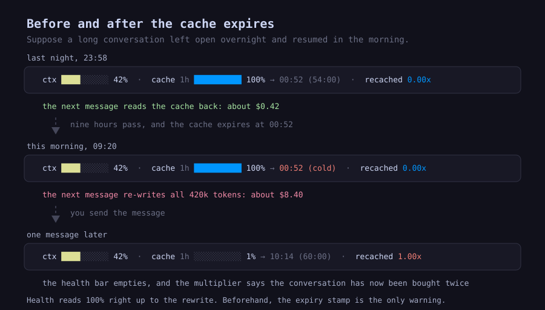
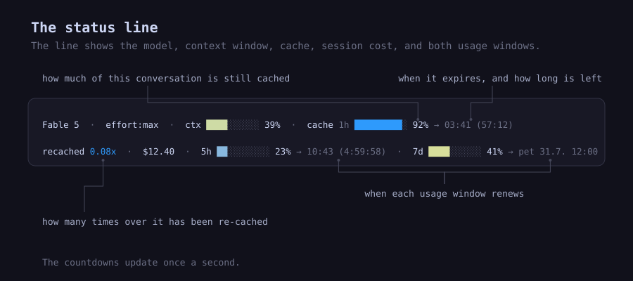
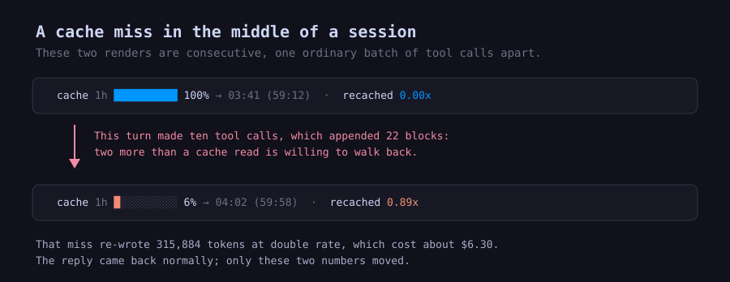

# Seeing what the prompt cache is doing

Claude Code re-sends your whole conversation to the model on every request, and the
prompt cache is what keeps that from costing full price each time. It works silently,
and it fails silently: when a request misses the cache, the conversation gets written
again at double rate, and the reply comes back looking exactly like every other reply.

All of it is recorded in the session transcript, though. Every API call leaves behind
how many tokens it read from cache and how many it had to write, which is enough to
reconstruct what the cache has been doing all session and put it on the status line.



The conversation is intact in all three frames. In this recorded example, the next
request after an overnight gap missed the cache, costing about $8.40 rather than
the $0.42 a cache read would have cost. The third frame records that request: the
health bar empties, and the multiplier records the repeated work. The current
display says `TTL elapsed` where this older illustration says `cold`.

## Expiry and renewal times

Each window shows a clock time, then how much is left: `→ ~03:41 (57:12)`
for the cache's estimated TTL boundary, `→ 10:43 (4:59:58)` for the five-hour usage window, and a weekday and
date for the weekly one. The countdowns update once a second.

Putting the clock time first solves a small problem worth mentioning. A status line only
redraws while you are working, so a session you left open an hour ago is still showing
what it showed then, and any countdown in it is wrong by exactly the time you were away.
A clock time remains useful after a pause. Once the estimated boundary passes,
the cache segment says `(TTL elapsed)`. This is a timing estimate, not proof of
cache deletion: the TTL starts at request start, while the transcript supplies
an assistant timestamp. The `~` marks that approximation. Unknown TTLs have no
expiry estimate; a mixed cache identifies the earliest, five-minute boundary.

## The other segments



The line also carries the model and effort level, how full the context window is, what
the session has cost so far, how much of each usage window is gone, and the session id.
The context bar embeds a fixed-width used/total label such as `245k/372k` or
`1.1M/1.0M`; without truecolor support it falls back to the same label as plain text.

### Terminal colors and narrow layouts

`NO_COLOR` disables ANSI styling. `CLAUDE_STATUSLINE_COLOR=always` forces truecolor
and `CLAUDE_STATUSLINE_COLOR=never` disables it; the default detects `COLORTERM` or a
`direct` terminfo entry. Set `CLAUDE_STATUSLINE_THEME=light` for the light palette
(the default is dark, or inferred from `COLORFGBG`). Palette entries can be overridden
with `CLAUDE_STATUSLINE_{ALARM,MUTED,BAR_DIM,BAR_ON_FILL,BAR_ON_DIM}_RGB`, using
`#rrggbb` or `r,g,b` values.

`CLAUDE_STATUSLINE_COMPACT=1` shortens separators and renewal stamps and omits the
session id. The embedded context value remains because it carries more information per
column than the lower-priority fields it replaces.

## Follow the selected subagent

On Claude Code 2.1.309, opening a subagent's transcript switches the status line to
that agent. Returning to the main conversation restores the main status line on
the next refresh. The selected agent's name or ID remains visible in compact mode.

| Segment | While viewing a subagent |
| --- | --- |
| Model | The model recorded in that agent's latest completed response |
| Effort | The agent's own observed setting, when available |
| Context | Input, cache-read and cache-written tokens from its latest response |
| Cache health, expiry and recached factor | Calculated from its own transcript |
| Cost | The whole session's total, explicitly labeled `session $…` |
| Organization and 5h/7d usage | The account's shared usage windows |

When the agent's context limit is unavailable, the context segment shows the
token count without a percentage. A missing agent transcript shows that it is
unavailable. It does not substitute the main conversation's measurements.

The bundled mod observes the terminal's `AbovePrompt.props.view` and passes the
selection through `CLAUDE_STATUSLINE_VIEW`. The C client copies that value into
each request to the shared renderer. Selection therefore belongs to the Claude
process that drew it, and the renderer checks the main session ID before using it.
Background agents completing work do not change which transcript is selected.

Selection and cleanup are stateful. A small helper owned by the native mod holds
a file lock while it is loaded. Unloading the mod or ending its process releases
the lock, so a leftover environment value is ignored on the next normal redraw.
The integration adds no recurring timer or heartbeat.

The plugin's `subagentStatusLine` command silently supplies native per-task model,
effort and context-limit metadata to the renderer. It leaves the task-row text
alone. If your own `subagentStatusLine` setting overrides that command, the
selected transcript still works and unknown context limits show a token count.

## Cache health

`cache 92%` is the share of this conversation's requests that have run since the last
time the cache was lost. It sits near 100% while things are working. When a request
fails to find the cache and has to send the conversation from scratch, it drops to
almost nothing and then climbs back as you keep working. Below 25%, the percentage is
alarm-colored so a failing cache outranks moderate context usage visually.

The `1h` beside it is how long this cache lives. On the main conversation, `5m` is
shown in red because the shorter cache lifetime can indicate overage. Subagents
normally use the five-minute cache, so their `5m` badge has a neutral color.

### What a cache miss means

`cache miss 12m ago` reports the latest substantial drop in cache reuse: more than
half of the comparable prior input footprint was not read from cache, after
ignoring differences below 2,048 tokens. The age is time since that request.
It does not diagnose a cause. The previous `hot`, `evicted` and `expired` labels
were based on fixed ten-minute and two-hour gaps, which did not account for the
actual TTL and could mislabel ordinary expiry.

Cache reuse can change because of elapsed retention time, a changed prefix or
configuration, or lookup behavior. Usage counters establish the amount reused.
See Anthropic's [prompt-caching documentation](https://platform.claude.com/docs/en/build-with-claude/prompt-caching)
for the current cache lifetime and invalidation rules.

## The re-cache multiplier

Health recovers, which makes it good for "is this working right now" and useless for
"what has this session wasted". So there is a second number that does not recover.

`recached 0.08x` counts the tokens this conversation has paid for more than once,
measured against its current size. At `0.08x` nearly everything has been bought once. At
`1.00x` the conversation has been paid for twice over. It falls only as the conversation
grows. Compaction starts a fresh cache-health chain while retaining the redundant
tokens already paid for.

## Mid-session cache misses



The picture above is a historical measurement: cache reuse fell after a batch of
tool calls, with about $6.30 of repeated work. Its explanation of individual
blocks reflects that earlier experiment. The current API groups consecutive
tool-use blocks and consecutive tool-result blocks when searching backward, so
ten parallel calls alone do not establish that the lookup window was exceeded.
The indicator reports the measured miss without attributing it to that mechanism.

## How it runs

Redrawing every second means the renderer has to be cheap, and this one is: about three
milliseconds a redraw, for a line that parses transcripts and keeps a database. A small
C client hands the harness's JSON to a resident Python renderer over a socket, and the
renderer answers most redraws from memory, since usually the only thing that changed is
the clock. It exits after ten idle minutes and restarts itself whenever you edit
it. If it cannot be reached at all, the client renders the line the slow way, so the
line never goes blank.

Your transcripts are only read, never written. The tool's own state is one small
database it can rebuild from the transcripts, so if the numbers ever look wrong you can
delete it and they come back. If you run a local proxy, your OAuth token is read and
hashed into a filename to find that proxy's usage file; the token is not sent anywhere,
and without a proxy that path never runs.

## Get started

```sh
./install.sh
```

That compiles the client, links the renderer into `~/.claude`, and links the
package into `~/.claude/skills/statusline-cachequota` so Claude Code loads its mod.
In an existing session, run `/reload-plugins`. The installer prints the settings
block for `~/.claude/settings.json` if the client is not configured:

```json
"statusLine": {
  "type": "command",
  "command": "~/.claude/statusline-client",
  "refreshInterval": 1
}
```

You need `python3`, a C compiler, and Claude Code 2.1.309 for the selected-view
integration. Everything honours `CLAUDE_CONFIG_DIR` if your Claude Code config
lives somewhere other than `~/.claude`. The package also provides its skill so
you can ask Claude Code to change the line:

> add a segment to my status line showing how long the session has been running

### Checks

Run these from this directory:

```sh
python3 -m unittest discover -v
claude plugin validate .
claude plugin test .
```

The Python tests cover the renderer and the compiled client's socket and
fallback paths. The native mod tests exercise selection changes, overlapping
background events, remote-view isolation and session cleanup without model calls.

## Under the hood

[`SKILL.md`](SKILL.md) has the exact definitions of both cache numbers, the layout of
the daemon, how to add a segment without freezing it, and the measured cache facts
behind all of it: what forking a large conversation costs, why a parked subagent goes
cold in five minutes while a teammate lasts an hour, and when the long-lived cache is
worth its higher write price.
